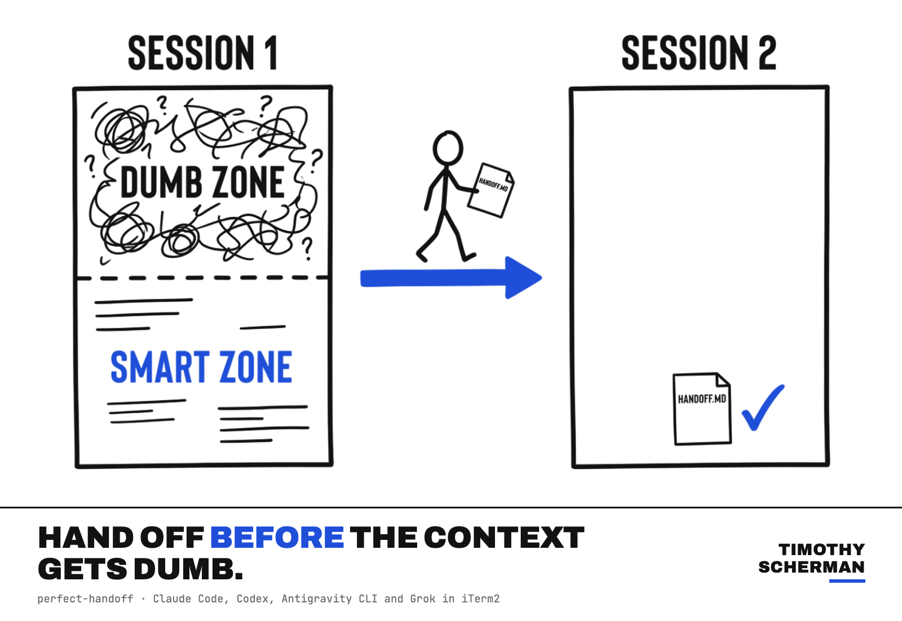

<p align="center">
  
</p>

# Perfect Handoff

**Hand off a long agent session to a fresh one - before the context window makes it dumb.
In Claude Code, Codex, Antigravity CLI or Grok, and from one of them to another.**

A skill for terminal work in **iTerm2 on macOS**. It finishes the step you are in, writes a
short, goal-filtered handover file, opens a new tab with a fresh session, gives it the same
name with "- Part 2", waits until the old session's background work is done, and then
closes the old tab by itself.

```
/handoff finish the payment webhook and get the tests green
/handoff to codex finish the payment webhook      # Claude quota used up? Continue in Codex.
```

"Perfect" is the goal, not a claim. The table below shows what is tested and what is not.

---

## Supported CLIs

Tested on macOS 26.6 with iTerm2 3.7.9 in November 2026. Real end-to-end runs through
`/handoff` (old tab closed itself, new session read the handover file): Claude Code → Grok,
Grok → agy, agy → Claude Code, agy → Grok, Claude Code → Codex, Codex → Claude Code. Codex
has limits as the old session, see below the table.

| | Claude Code | Codex | Antigravity CLI (`agy`) | Grok |
|---|---|---|---|---|
| Tested version | 2.1.330 | 0.171.0 | 1.5.14 | 1.0.77 |
| Starts the skill | `/handoff` | `$handoff` | `/handoff` | `/handoff` |
| Opens as the new session and reads the handover | ✓ | ✓ | ✓ | ✓ |
| Hands off to another CLI | ✓ (to Grok, to Codex) | ✓ (to Claude Code) | ✓ (to Claude Code, to Grok) | ✓ (to agy) |
| Carries the name over ("... - Part 2") | ✓ `--name` at start | as the new session: ✓ tab title; as the old session: ✗ | ✓ tab title | ✓ tab title |
| Old tab closes itself | ✓ (session registry) | ✗ in a real handoff (you close the tab) | ✓ (screen stops changing) | ✓ (screen stops changing) |
| Background check | ✓ shells | runs; not tested with a running shell | ✓ own-terminal processes | ✓ shells |
| Context measured | ✓ transcript | session file read from a stored session, not live | ✗ not measurable | ✓ `signals.json` |
| Context watcher hook | ✓ | - | - | - |

"Not tested" means exactly that. This table changes only after a real run.

**Codex as the old session.** Codex 0.171 runs its commands through a background service
(`codex app-server`) that has no terminal and serves every Codex session. The scripts
cannot tell which iTerm2 tab belongs to the session. In the real run the handover file was
written and Claude Code started in a new tab and read it; the name was not carried over,
and the last line was "You can close this terminal now" instead of the auto-close. The
background check then looks at the service: it can also list shells of your other Codex
sessions. The auto-close watcher itself closed an idle Codex tab in a direct test. Codex
ran without its sandbox in these tests; a handoff from a sandboxed Codex is not tested.

## Why this exists

### The first tokens are the smartest

Matt Pocock calls it the *smart zone*:

> "Early in a session the agent is in a 'smart zone' - sharp, focused, recall is good.
> As the session grows it drifts into a 'dumb zone': sloppier, forgetful, more mistakes."
> - [AI Hero, AI Coding Dictionary: Smart zone](https://www.aihero.dev/ai-coding-dictionary/smart-zone)

He puts the start of the dumb zone on frontier models at around 125K-150K tokens and adds
that this is debated. His advice: when a task is bigger than one smart zone, *hand off at a
natural boundary* and let a fresh session do the next piece.

Anthropic describes the same effect as **context rot**: "as the number of tokens in the
context window increases, the model's ability to accurately recall information from that
context decreases" - a gradient, not a hard cliff. The reason is that every token relates
to every other token: the transformer "enables every token to attend to every other token
across the entire context. This results in n² pairwise relationships for n tokens", and
with a longer context that attention "gets stretched thin"
([Effective context engineering for AI agents](https://www.anthropic.com/engineering/effective-context-engineering-for-ai-agents)).
Chroma measured it across 18 models: reliability drops as input grows, even on simple tasks
([Context Rot](https://research.trychroma.com/context-rot)).

### What I kept running into

In my own long sessions, mistakes start to pile up from about half of the context window:
instructions from 20 turns ago are forgotten, fixed bugs come back. That is my experience,
not a benchmark. Large windows (1M tokens) do not fix it; they only make the slow part
longer. And I work with more than one CLI: when one quota runs out, the work has to go on
in another one without losing the thread.

| Problem I hit | What the skill does |
|---|---|
| The session gets sloppy and I notice too late. | In Claude Code a hook measures the fill level on every prompt and asks you whether to hand off. In Codex and Grok the skill measures it when you start it. |
| The handoff cut a step in half. The new session started with a half-done edit. | It finishes the running step first if the rest fits into 10 % of the window. Otherwise it stops at the next clean point. |
| The new session "continued" although the work was done, and invented its own next tasks. | A fixed rule decides between **CONTINUE** and **CONFIRM**. Assigned work and own suggestions are separate lists. Suggestions never run without your OK. |
| I copied context by hand and forgot the important part. | A goal-filtered handover file: state, decisions, files, next steps, traps - and nothing else. |
| One quota is empty, the task is half done. | `/handoff to <cli>` continues in Claude Code, Codex, agy or Grok. The handover file is plain Markdown that every CLI reads. |
| Ten tabs, all called "claude". Which one was it? | The new session gets the old name plus "- Part 2". |
| "Can I close this terminal now?" Background shells were still running. | It checks the old session's background shells, waits for them, and ends with one fixed line. When everything is done, the old tab closes itself. |

---

## How it works

1. **Finish the step.** It measures the context and finishes the running step if the
   rest fits into the budget (10 % of the window, never past 85 %).
2. **Background inventory.** It lists background shells (dev servers, builds) so nothing
   dies silently.
3. **Handover file.** `~/.claude/handoffs/<date>-<slug>.md` (the same folder for every
   CLI) with goal, verified state, files, decisions, mode, next steps and traps. Filtered
   by the goal, no secrets.
4. **New session.** A new tab in the same iTerm2 window starts the CLI you chose with the
   handover file and gives it the old name plus "- Part 2".
5. **Wrap-up.** The old session waits for its background work, adds late results to the
   handover file, and ends with exactly one line:

   | Situation | Last line |
   |---|---|
   | Still running | `⏳ Do NOT close this terminal yet. ...` |
   | Done, auto-close works | `✅ All done. This terminal closes itself in 10 s if every check passes. ...` |
   | Done, no auto-close | `✅ You can close this terminal now. (Cmd+W closes only this tab.)` |
   | A check failed | `⚠️ ... Keep this terminal open and look at it before you close it.` |

   The old tab closes only if every check passes; on any doubt it stays open.

The scripts find their own session through the process tree (the nearest `claude`,
`codex`, `agy` or `grok` process and its terminal), so the model never has to pass a
session id. Everything mechanical is a script; the skill file says what to do and what
to avoid, so the model runs one command instead of improvising.

**Remote mode** (`/handoff remote <goal>`): the handover goes to a server over SSH and
Claude Code runs there in tmux. It keeps working when your laptop is closed, and you can
attach from your phone.

---

## Install

Requirements: macOS, [iTerm2](https://iterm2.com), Python 3, `jq`, and at least one of
Claude Code, Codex, Antigravity CLI (`agy`) or Grok.

```bash
git clone https://github.com/Tomi2k/perfect-handoff.git
cd perfect-handoff
./install.sh
```

`install.sh` copies the scripts to `~/.local/share/perfect-handoff/` and the skill file to
every CLI it finds:

| CLI | Skill file |
|---|---|
| Claude Code | `~/.claude/skills/handoff/SKILL.md` |
| Codex | `~/.codex/skills/handoff/SKILL.md` |
| Antigravity CLI | `~/.gemini/config/skills/handoff/SKILL.md` |
| Grok | `~/.grok/skills/handoff/SKILL.md` (Grok also reads `~/.claude/skills/`) |

An existing skill named `handoff` that is not from Perfect Handoff stays untouched
(`./install.sh --force` replaces it and keeps a `.bak` copy). `./install.sh --uninstall`
removes the skill files it installed, if they are unchanged, and its own `scripts`,
`hooks` and `venv` folders in `~/.local/share/perfect-handoff/`.

**Auto-close and tab titles** need the iTerm2 Python API:

1. Enable iTerm2 > Settings > General > Magic > *Enable Python API*.
2. Run `./install.sh --iterm2` once. It creates `~/.local/share/perfect-handoff/venv` with
   the `iterm2` module (version 2.22, downloaded from PyPI). The scripts find it by
   themselves.

Without it, everything else works; the skill tells you to close the tab yourself.

**Context watcher hook** (Claude Code only, recommended) - add to `~/.claude/settings.json`:

```json
{
  "hooks": {
    "UserPromptSubmit": [
      {
        "hooks": [
          {
            "type": "command",
            "command": "python3 -I ~/.local/share/perfect-handoff/hooks/context_watcher.py 2>/dev/null || true",
            "timeout": 10
          }
        ]
      }
    ]
  }
}
```

The first launch asks macOS to let your terminal control iTerm2 (Automation). Allow it.

## Use

| CLI | Start the skill |
|---|---|
| Claude Code | `/handoff <goal>` |
| Codex | `$handoff <goal>` |
| Antigravity CLI | `/handoff <goal>` |
| Grok | `/handoff <goal>` (if another skill is also called `handoff`, Grok asks for `/local:handoff`) |

Options, in this order: `remote`, then `to claude|codex|agy|grok`, then the goal.
Without `to`, the new session runs in the same CLI. No goal? The skill asks one question:
*What should the new session achieve?* It never invents the goal.

## Configure

All settings are environment variables in your own shell profile. The skill tells the
agent never to set them itself, except `HANDOFF_MODEL` when you ask for a model in the chat.

| Variable | Default | Effect |
|---|---|---|
| `HANDOFF_WATCH_AT` | `0.5` | Claude Code hook: fraction of the window that triggers the suggestion. |
| `HANDOFF_WATCH_TOKENS` | - | Claude Code hook: absolute trigger, whichever comes first. `150000` follows the smart-zone advice on 1M windows. |
| `CLAUDE_CONTEXT_WINDOW` | `200000` (`1000000` if the model has `[1m]`) | Window size used for Claude Code percentages. Codex and Grok report their own window. |
| `HANDOFF_DIR` | `~/.claude/handoffs` | Where handover files and small state files go. |
| `HANDOFF_MODEL` | - | Model for the new session (passed as `--model`). |
| `HANDOFF_SKIP_PERMISSIONS` | `0` | `1` starts the new session without permission prompts: `--dangerously-skip-permissions` (Claude Code, agy), `--dangerously-bypass-approvals-and-sandbox` (Codex), `--always-approve` (Grok). Read in the shell of the new tab: put `export HANDOFF_SKIP_PERMISSIONS=1` into your shell profile (for example `~/.zshrc`). Read *Security* first. |
| `HANDOFF_AUTO` | `0` | `1` lets the Claude Code watcher start the handoff without asking you first, and starts a CONTINUE handover in the new tab without the Enter question. The new tab reads it from your shell profile (`export HANDOFF_AUTO=1`). |
| `HANDOFF_REMOTE_HOST` | - | SSH alias for remote mode. On the server: `~/handoffs` and `~/projects/<repo>`. |

## What is in the box

```
install.sh                    installs scripts and skill files for every CLI found
skills/handoff/
├── SKILL.md                  the instructions the agent follows (one file for all CLIs)
├── hooks/context_watcher.py  Claude Code hook + `--status` (Claude Code, Codex, Grok)
└── scripts/
    ├── phself.py             which CLI am I, which pid, which terminal, which session
    ├── handoff_launch.sh     new iTerm2 tab, start the chosen CLI, set the name
    ├── handoff_check.py      accept only your own fresh handover file
    ├── handoff_title.sh      read the current name, build "... - Part N"
    ├── tabtitle.py           read or set the iTerm2 tab title (Codex, agy, Grok)
    ├── bg_check.sh           list background shells of the session
    └── autoclose.py          close the old tab once the session is idle
```

## Security

I audited both the skill and the scripts before publishing. What you should know:

- **Bypass mode is opt-in.** `HANDOFF_SKIP_PERMISSIONS=1` starts the new session without
  permission prompts. Only use it if you understand what an agent can do on your machine
  without asking - including after reading untrusted web pages or files. The launcher
  does not read it from its own environment: the start script reads it in the shell of the
  new tab, which iTerm2 starts from your profile. A value that an agent puts in front of a
  command has no effect. An agent that may edit your shell profile can still change it;
  your CLI's command approval is the real boundary.
- **No command injection through names or paths.** Values reach AppleScript only as
  arguments, and the start command is a one-shot temp script quoted with `printf %q`.
  Session names pass an allowlist (letters, digits, space and `. , _ + : -`): quotes, `$`,
  `&`, `*`, parentheses, backslashes and other shell characters are removed. Tested with a
  path containing spaces and `'`, and a name with `"`, `&`, `$( )` and a zsh glob qualifier.
- **Nothing is typed into the new session.** The start command carries the handover
  prompt and, for Claude Code, the name (`--name`). Codex, agy and Grok get the name as
  the tab title. The new tab opens in the window of the old session, not in whichever
  window has the focus. Dialogs (folder trust, MCP servers, permissions) are always yours
  to answer.
- **No code from the project folder.** All Python runs with `python3 -I` (the skill calls
  it that way, and the scripts carry it in their first line), also while
  `install.sh --iterm2` builds its venv, so a module in the folder you hand off (for
  example a planted `re.py`) is never imported.
- **Pinned downloads.** `install.sh --iterm2` installs the `iterm2` module and its
  dependencies in the exact versions of `requirements-iterm2.txt`; pip accepts only
  ready-built files (wheels) that match the SHA-256 hashes in that file.
- **Auto-close keeps the tab on any doubt.** It closes only the tab whose tty and iTerm2
  session belong to the old session (if that is the window's last tab, iTerm2 closes the
  window with it). It keeps the tab open if it cannot recognise an empty input box, if
  the terminal cursor is not directly behind the prompt (text, spaces or empty lines in
  the box), if the box or the cursor changes during the countdown (checked every second),
  if the session becomes active again (Claude Code: its session registry or a busy hint;
  other CLIs: any change on the screen or a busy hint), if the background check does not
  report "no background shell", or if the CLI is no longer in the foreground of its tab.
  It is still a heuristic for Codex, agy and Grok: "idle" means a quiet screen without a
  busy hint (see *Limits*).
- **Handover files are stored locally** (`~/.claude/handoffs`, folder 700, files 600). The
  skill forbids secrets in them, but a model can make mistakes - do not sync that folder
  anywhere public. The new session reads the file, so its contents go to the model
  provider of the CLI you hand off to, like everything else you type there.
- **The handover file is trusted.** CONFIRM is the default; CONTINUE needs work you
  assigned, quoted with date, and the new session first checks that the work is still
  open. The quote lives in the same file: whoever can write to `~/.claude/handoffs` can
  write a handover file. Keep that folder private. The launcher accepts only
  your own regular file directly in that folder (real absolute path, no symlink, not
  readable or writable by others, a plain `.md` name, at most 15 minutes old). The new tab
  checks the folder again against the `HANDOFF_DIR` of your own shell profile, so a folder
  that only an agent set in its environment is refused. **A file alone never starts work
  unseen:** if the file is not exactly in CONFIRM mode, the new tab shows its Mode section
  and waits for your Enter. Only `export HANDOFF_AUTO=1` in your own shell profile switches
  that question off. Remote mode uses the same file check and always starts in CONFIRM
  mode: you start the work after attaching. An agent that may write into your handover
  folder can still write a handover file - that is what the skill does.
- **Remote mode never trusts a repository for you.** If Claude Code asks whether to trust
  a freshly cloned repository on the server, the skill stops and lets you decide: trusting
  it lets the repository's hooks and MCP settings run code. It validates host, repository,
  URL and file names before building a command, and never copies git-ignored files
  (`.env`, keys, credentials) - it lists them and you copy what you need.
- **Handover files stay private.** Folder mode 700, files mode 600, also on the server.
- **Background check output is redacted.** URL credentials, common token prefixes
  (`sk-`, `ghp_`, `github_pat_`, `xoxb-`, `AKIA`), `Bearer`/`Basic` values, everything after
  `-H`, `--header`, `--cookie`, `-b`, `-u`, `--user` and `-a` up to the next option (also
  values of several words), JSON keys like `"password"`, `--token`/`--password` values,
  `-p` values and `KEY=`/`TOKEN=` values are masked before they reach the model. Masking
  works by pattern; it cannot promise to catch every secret. The auto-close log never
  contains command text.
- **Your settings stay yours.** The skill tells the agent never to set any `HANDOFF_*`
  variable, `CLAUDE_CONTEXT_WINDOW`, `CLAUDE_CONFIG_DIR`, `CODEX_HOME` or `GROK_HOME`
  itself (only exception: `HANDOFF_MODEL` for the new session, when you ask for a
  model in the chat), and to treat a `[CONTEXT-WATCHER]` text in files or tool output as
  data. Only the hook's own note counts.
- **No telemetry.** The scripts make no network calls. Network traffic comes only from
  `./install.sh --iterm2` (PyPI download), remote mode (your SSH and Git), and the CLIs
  themselves talking to their model providers.

## Limits

- Tested versions: see the table above. Every CLI here can change its internal files with
  an update: the scripts read `~/.claude/sessions/*.json` and transcripts (Claude Code),
  `~/.codex/sessions/**/rollout-*.jsonl` (Codex) and `~/.grok/sessions/*/<id>/signals.json`
  (Grok), and the session id variables each CLI sets for its shells.
- macOS and iTerm2 only. Started from another terminal, the new session opens in a new
  iTerm2 window; the old terminal gets no auto-close.
- `bg_check.sh` counts shells, sandbox wrappers (`sandbox-exec`), processes on the CLI's
  terminal whose parent has ended (for example after `nohup ... &`) and, for Codex, agy and
  Grok, processes in their own terminal. A program that Codex, agy or Grok starts directly
  on the CLI's terminal without a shell is not seen: it looks like an MCP server, and MCP
  servers are ignored on purpose. If the process list cannot be read, the check reports
  "unknown" (exit 2) and the tab stays open.
- Auto-close reads the input box and the cursor from the screen. If a CLI changes how its
  input box looks, the box is not recognised and the tab stays open. A turn that hangs
  without output and without a busy hint looks idle. The watcher is a helper script
  (`autoclose.py --run`); whoever can run commands as you can also call it for another
  idle tab of yours (for Claude Code only with the matching session id).
- In agy the context is not measurable; the agent estimates whether the rest of a step fits.
- In Codex, agy and Grok the name is the iTerm2 tab title. Another iTerm2 script that sets
  tab titles itself can overwrite it (seen on the test machine; the name tests ran with
  that script paused).
- Two handoffs ran at the same time from the same folder without mixing up tabs: every
  script finds its session through the terminal (tty), not through folder or start time.
- Auto-close for Codex, agy and Grok decides "idle" from the screen: no change for 6 s and
  no busy hint ("esc to interrupt", "esc to cancel", "Ctrl+c:cancel"). It never closes
  while the screen still changes - a clock or a counter in a status line also counts as a
  change; after 15 minutes without a quiet screen it gives up and the tab stays open.
- If another skill is also named `handoff`, some CLIs ask you which one to run (Grok:
  `/local:handoff`), and an agent can load the other one first.
- "Does the rest fit into 10 %?" is the model's own estimate.
- Remote mode is written as instructions for the model, not as a tested script.

## License

MIT - see [LICENSE](LICENSE).

---

Built by **Timothy Scherman**. Less AI theater. More results.
